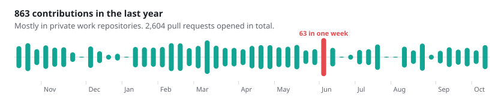

<picture>
  <source media="(prefers-color-scheme: dark)" srcset="./profile/banner-dark.svg">
  
</picture>

## 🎯 What I do

I bridge **technical execution and business goals**: I make architecture decisions, keep code quality high, and mentor engineers while delivery stays on track.

- 🏗️ Define and drive **technical direction** across microservice ecosystems
- 👥 **Mentor and grow** engineering teams through code reviews, pairing, and design discussions
- 📐 Make **architecture decisions** for distributed systems at scale
- 🔗 Keep **engineering, product, and stakeholders** aligned
- ⚡ Balance **technical debt and delivery**: know when to refactor and when to ship

## 🧰 Hands-on work

- 🔧 Build and maintain **distributed backend services**
- 🎨 Develop frontend experiences with **React, Next.js**, and **Cloudflare Pages**
- 🐳 Design **Docker-based dev environments** for large microservice ecosystems
- 🛠️ Create **developer tooling**: Chrome extensions and CLI utilities
- 🎬 Work on **video processing pipelines** and player components

## 🔧 Tech stack

<table>
  <tr>
    <td><b>Backend</b></td>
    <td>
      
      
      
    </td>
  </tr>
  <tr>
    <td><b>Frontend</b></td>
    <td>
      
      
    </td>
  </tr>
  <tr>
    <td><b>Data</b></td>
    <td>
      
      
      
      
    </td>
  </tr>
  <tr>
    <td><b>Messaging</b></td>
    <td>
      
      
    </td>
  </tr>
  <tr>
    <td><b>Infrastructure</b></td>
    <td>
      
      
      
      
    </td>
  </tr>
  <tr>
    <td><b>Video</b></td>
    <td>
      
      
      
    </td>
  </tr>
</table>

## 🌱 Mentoring at Step4ward

I'm a mentor at [**Step4ward**](https://step4ward.es/), a non-profit community created **by and for women in tech** in Spain. Since 2021, Step4ward connects experienced professionals with women entering or growing in the tech industry, with personalized mentorship, workshops (Step4wardTalks and Step4wardLabs), and career resources.

If you're a woman in tech looking for guidance, or an experienced professional who wants to give back, get involved!

## 📊 Activity

<picture>
  <source media="(prefers-color-scheme: dark)" srcset="./profile/activity-dark.svg">
  
</picture>

---

*"First do it, then do it right, then do it better."*

